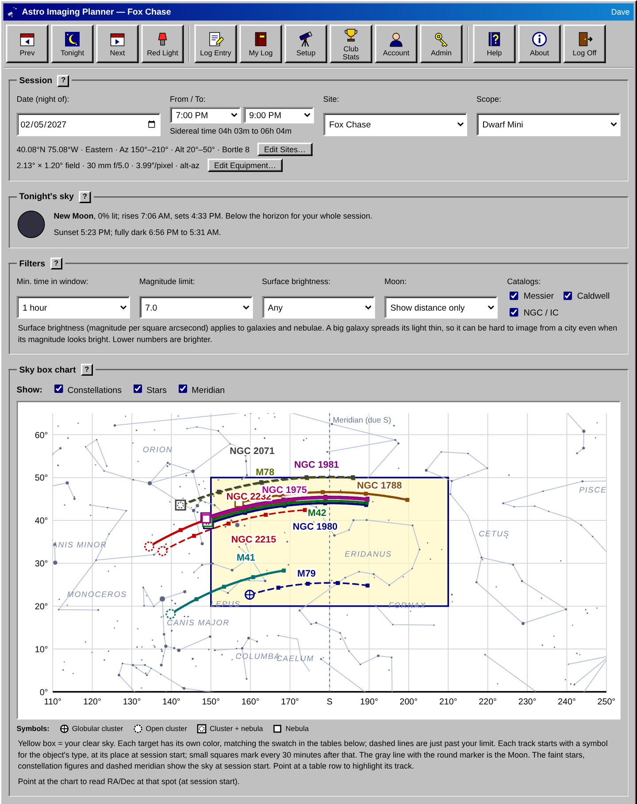
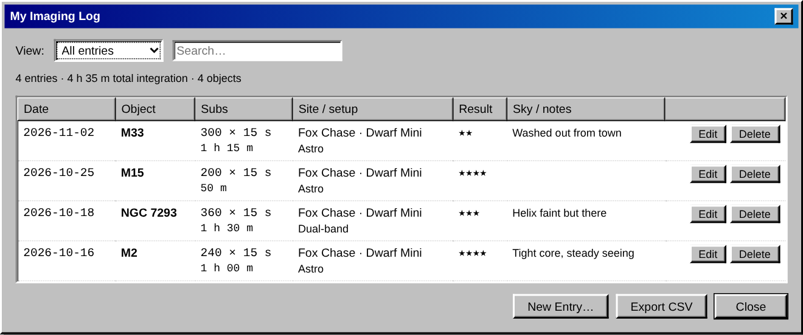
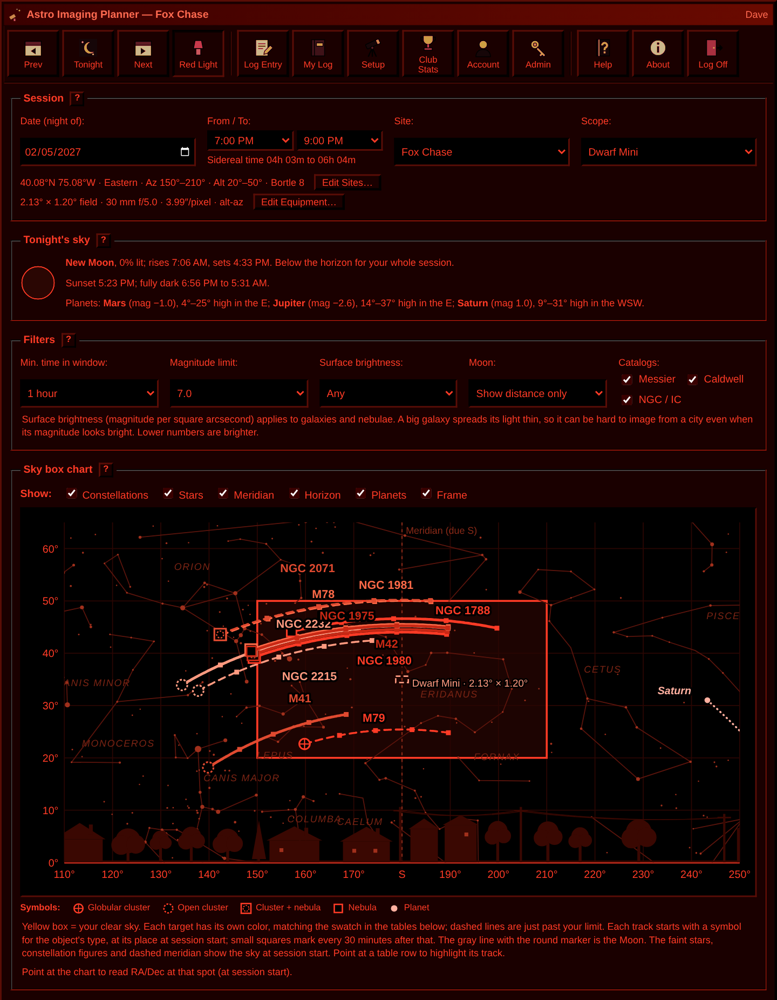
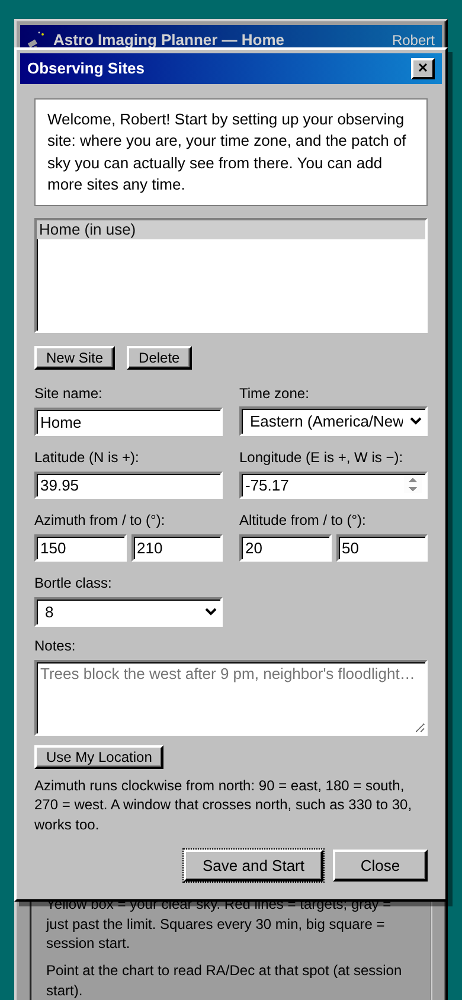

# Astro Imaging Planner

**What can I image tonight, from *my* yard, in the two hours I have?**

Astro Imaging Planner is a small, invite-only web app for people imaging deep-sky objects with smart telescopes such as the Dwarf Mini, Dwarf 3 or Seestar. You describe the patch of sky you can actually see from your yard and your evening session, and it lists the Messier, Caldwell and NGC/IC objects that will stay in that window for as long as you need. Every member keeps an imaging log, and the log feeds back into the planner, so you can see at a glance what you've already captured and what's still waiting.

It's built for a group of friends, with an unapologetically 1990s desktop look and a red night-vision mode for use at the telescope.



## Why

Most planning tools assume a dark site and an open horizon. In a city or suburban backyard you might have one clear wedge of sky between the house and the trees, Bortle 8 skies, and a couple of hours after dinner. The question isn't "what's up tonight?" but "what will sit in *that* gap long enough to stack, and is it bright enough to be worth it?" This app answers exactly that question.

## Features

**Planning**
- **Your own sky box.** Set the azimuth and altitude range you can actually see. Windows that cross north, such as 330° to 30°, work too.
- **Time in the window.** Each object's path is computed minute by minute across your session. An object is listed only if it stays inside your box for the minimum time you choose, from 30 minutes to 2 hours.
- **Catalogs:** all 110 Messier objects, 108 of the 109 Caldwell objects (the Coalsack, a dark nebula, is left out), and every NGC/IC deep-sky object down to magnitude 10.5: 726 in all, from [OpenNGC](https://github.com/mattiaverga/OpenNGC). Each member chooses which catalogs to use. Cross-references mean M31, NGC 224 and "Andromeda Galaxy" are one object.
- **Brightness limit**, plus a "just past your limit" list of objects up to 1.5 magnitudes fainter.
- **Surface brightness filter** for galaxies and nebulae, so large, diffuse objects that drown in city light can be filtered out even when their total magnitude looks bright.
- **The Moon:** phase picture, percent lit, rise and set times, its track on the chart, and each target's distance from it, flagged when a bright Moon is too close. Optionally hides targets the Moon washes out.
- **Darkness:** sunset and astronomical twilight times, with a note when your session starts before full dark.
- **Sky box chart** showing your window and each target's track across it, with 30-minute markers.
- **RA and Dec everywhere.** Each target shows J2000 coordinates, the window's RA/Dec footprint is shown at the start and end of the session, and pointing at the chart reads out RA/Dec at that spot.
- **Prev / Tonight / Next** buttons to scan ahead through the season.

**Logging**
- An **imaging log** for each member: date, object, site, number and length of subs, gain, filter, sky conditions, a star rating and notes.
- Totals per object, with search and **CSV export**.
- The planner marks every target "Not yet" or "1 h 15 m · 2 sessions", and can sort the ones you haven't imaged to the top.

**Accounts**
- **Invite-only.** The admin creates single-use invite links; there's no public sign-up.
- **Multiple sites per member**, each with its own location, time zone, sky box and Bortle class, plus a **Use My Location** button.
- Settings follow you between devices.
- Works on phones and desktops.

**At the telescope**
- **Red Light mode** turns the whole interface black and red to protect your night vision.

<p>
  
  
</p>
<p align="center"></p>

## How it works

All the astronomy runs in the browser, in [`static/astro.js`](static/astro.js), with no external services:

1. Catalog positions (J2000) are precessed to the session date.
2. For every minute of the session, local sidereal time gives each object's hour angle, which converts to altitude and azimuth for the site.
3. The app finds each object's longest continuous run inside the sky box and keeps those that meet the minimum time and magnitude limit.
4. For the RA/Dec readouts, the sky box's edges are converted the other way, from alt/az back to J2000 RA/Dec.
5. The Sun and Moon come from the main terms of Meeus's series (*Astronomical Algorithms*, chapters 25 and 47). Checked against PyEphem, Moon positions agree to within 0.05° and rise, set and twilight times to within a minute.

The catalog is `static/catalog.json`, built from OpenNGC by `tools/build_catalog.py`. To rebuild it with newer OpenNGC data, download `NGC.csv` and `addendum.csv` from OpenNGC's `database_files` folder and run:

```sh
python tools/build_catalog.py NGC.csv addendum.csv > static/catalog.json
```

The approximations (simple precession, no refraction, no nutation) are accurate to well under a degree. That's far finer than any backyard sky box.

The server only stores accounts, sites, settings and logs. It never does any sky math.

## Tech stack

- **Backend:** Python 3.9+, [Flask](https://flask.palletsprojects.com/), SQLite (a single file), gunicorn
- **Frontend:** plain HTML, CSS and JavaScript, with no framework and no build step
- **Hosting:** any Linux server behind nginx or Caddy. The reference install runs on a small Hetzner Cloud VM with HTTPS from Let's Encrypt.
- **Dependencies:** `flask`, `gunicorn`, `tzdata`. That's all.

## Quick start (local)

```sh
git clone <this repo>
cd astro-planner
python3 -m venv venv
. venv/bin/activate                # Windows: venv\Scripts\activate
pip install -r requirements.txt
python manage.py create-admin yourname --name "Your Name" --lat 40.08 --lon -75.08
flask --app app run --debug
```

Open http://127.0.0.1:5000 and sign in. Click **Admin**, then **Create Invite**, to add another account.

## Deploying

The [Administrator's Guide](ADMIN.md) covers the full production setup step by step:

- systemd service, nginx reverse proxy and HTTPS with certbot
- inviting and managing members
- **backups:** nightly server bundles (database, settings and a manifest with an integrity check), an automatic nightly pull to a Windows PC, and an on-demand **Download Backup** button
- **restores:** a one-command restore that checks the backup first and can be undone, plus rebuilding on a new server and a restore drill
- updating, troubleshooting and a quick-reference command card

## Project layout

```
app.py              Flask app: pages and JSON API
db.py               SQLite schema and helpers
manage.py           Admin CLI: invites, users, password resets, backup, verify
static/
  astro.js          Sky math: positions, Sun, Moon, twilight
  catalog.json      726 objects built from OpenNGC
  app.js            Browser UI
  retro.css         The retro theme and red-light mode
templates/          Main page, sign-in and sign-up
deploy/
  astro-planner.service   systemd unit
  backup.sh / restore.sh  Nightly backup bundle and one-command restore
  windows/                PowerShell scripts that pull backups to a PC
tools/
  build_catalog.py  Rebuilds static/catalog.json from OpenNGC
ADMIN.md            Administrator's Guide
```

## Security

- Passwords are stored as salted scrypt hashes.
- Every query is scoped to the signed-in member. Members never see each other's sites or logs.
- CSRF tokens on forms, a custom-header check on API writes, rate-limited sign-in, and HTTP-only, SameSite, HTTPS-only session cookies.
- The app runs as an unprivileged system user and listens only on localhost behind the reverse proxy.

Found a problem? Please open an issue rather than posting details publicly.

## Roadmap

- In-app **Help** window
- Horizon profile (obstruction height every 10° of azimuth) instead of a rectangular box
- "Fits the frame" check against each telescope's field of view
- Sharpless and other emission-nebula catalogs for duo-band imaging
- Herschel 400 list with progress tracking
- Thumbnails on log entries

## Version history

| Version | Date | Changes |
|---|---|---|
| 1.2.0 | 2026-10-19 | Full Messier, Caldwell and NGC/IC catalogs from OpenNGC (726 objects) with a Catalogs setting; surface brightness filter; Moon phase, rise/set, chart track and per-target Moon distance; sunset and twilight times; Red Light tints the toolbar icons |
| 1.1.1 | 2026-10-19 | Sky box chart: a color per target matching the table, dashed lines for near-limit targets, haloed labels that avoid other tracks, row-hover highlighting, taller chart |
| 1.1.0 | 2026-10-19 | Download Backup button; backup bundles with settings and manifest; restore script; Windows backup pull; `manage.py verify`; Administrator's Guide |
| 1.0.0 | 2026-10-17 | First release: accounts and invites, sites, planner, imaging log, retro UI |

## Author

Dave Doler, K3DFD, Philadelphia.

## Credits

Catalog data: [OpenNGC](https://github.com/mattiaverga/OpenNGC) by Mattia Verga, licensed [CC-BY-SA 4.0](https://creativecommons.org/licenses/by-sa/4.0/). `static/catalog.json` is derived from it and shares that license.

## License

To be decided.
